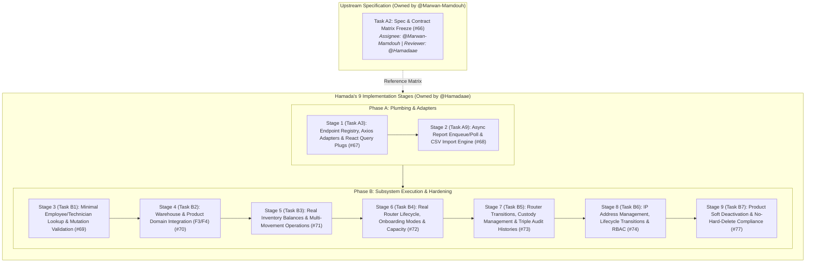

# Phase 2 Master Execution Plan: 10-Issue Roadmap

This document serves as the master engineering plan for Phase 2 across **Phase A** (Contracts, API Registry, Integration Plumbing) and **Phase B** (Subsystem Implementations & Hardening).

---

## 1. Ownership & Roles Breakdown

Reviewing the issue specifications confirms the division of accountability:
- **@Marwan-Mamdouh (Upstream Spec Owner):** Owns **Task A2 (#66)** — Phase 2 Spec & Contract Matrix Freeze. (Reviewer: @Hamadaae).
- **@Hamadaae (Primary Implementation Owner):** Owns the **9 implementation tasks** (A3, A9, B1, B2, B3, B4, B5, B6, B7). (Reviewer: @Marwan-Mamdouh).

Because the backend controllers, DTOs (`@alfahd/types`), and route constants (`routes.constants.ts`) are already fully implemented and verified in `apps/api`, **Hamada is not blocked by Task A2** and starts directly on **Task A3 (Stage 1 of Hamada's implementation track)**.

---

## 2. 10-Issue Roadmap Diagram



---

## 3. Master Task Matrix

| Hamada Stage | Task ID | Phase | Assignee | Reviewer | Focus Area | Status |
| :---: | :--- | :---: | :---: | :---: | :--- | :---: |
| *Ref* | **Task A2** (#66) | Phase A | @Marwan-Mamdouh | @Hamadaae | Phase 2 Contract Matrix & API Specification Freeze | *Marwan's Task* |
| **Stage 1** | **Task A3** (#67) | **Phase A** | **@Hamadaae** | @Marwan-Mamdouh | Endpoint Registry, Axios Client, React Query Hooks, Pagination Normalization | **Ready for Execution** |
| **Stage 2** | **Task A9** (#68) | **Phase A** | **@Hamadaae** | @Marwan-Mamdouh | Async Report Enqueue/Polling Engine, Protected Downloads & CSV Import | **Planned** |
| **Stage 3** | **Task B1** (#69) | **Phase B** | **@Hamadaae** | @Marwan-Mamdouh | Minimal Employee/Technician Selector Lookup API & Target Mutation Validation | **Planned** |
| **Stage 4** | **Task B2** (#70) | **Phase B** | **@Hamadaae** | @Marwan-Mamdouh | Warehouse & Product Domain Integration (F3/F4 Containers, Deactivation 409) | **Planned** |
| **Stage 5** | **Task B3** (#71) | **Phase B** | **@Hamadaae** | @Marwan-Mamdouh | Real Inventory Balances, Multi-Movement Operations & Serialization Guardrails | **Planned** |
| **Stage 6** | **Task B4** (#72) | **Phase B** | **@Hamadaae** | @Marwan-Mamdouh | Real Router Lifecycle, Onboarding Modes (`isNewReceipt`) & Capacity Guardrails | **Planned** |
| **Stage 7** | **Task B5** (#73) | **Phase B** | **@Hamadaae** | @Marwan-Mamdouh | Router Transitions, Custody Management & Triple Audit Histories | **Planned** |
| **Stage 8** | **Task B6** (#74) | **Phase B** | **@Hamadaae** | @Marwan-Mamdouh | IP Address Management, Lifecycle Transitions & RBAC Mirroring | **Planned** |
| **Stage 9** | **Task B7** (#77) | **Phase B** | **@Hamadaae** | @Marwan-Mamdouh | Product Soft Deactivation Semantics, No-Hard-Delete Compliance & Migration | **Planned** |

---

## 4. Reference Task A2: Phase 2 Spec & Contract Matrix Freeze (Marwan's Task)

### A. Context & Ownership
- **Assignee:** @Marwan-Mamdouh
- **Reviewer:** @Hamadaae
- **Estimate:** 4–6 person-hours
- **Boundary:** Specification and documentation layer; shared contracts across `apps/api` and `apps/web`.

### B. Core Deliverables (For Reference)
1. **Authoritative Specification Document**:
   `specs/006-phase2-frontend-hardening/contracts/phase2-contract-matrix.md` and `specs/006-phase2-frontend-hardening/spec.md`.
2. **Contract Snapshots for All 7 Domains**:
   - **Employees**: `GET /employees` (paginated), `POST /employees`, `GET /employees/:id`, `PATCH /employees/:id`, `PATCH /employees/:id/status`, `POST /employees/:id/photo`, `GET /employees/lookup`.
   - **Attendance**: `POST /attendance/check-in`, `POST /attendance/check-out`, `GET /attendance`, `POST /attendance/:id/override`, `GET /attendance/report`.
   - **Warehouses**: `GET /warehouses`, `POST /warehouses`, `GET /warehouses/:id`, `PATCH /warehouses/:id`, `DELETE /warehouses/:id`.
   - **Products & Inventory**: Catalog listing, stock balance queries, `GET /products?activeOnly=true`, and serialization guardrails.
   - **Routers**: Inbound receipt (+1 stock), existing opening-stock registration (+0 delta), damaged opening reconciliation (-1 adjustment), technician assignment, transitions, condition updates, and audit histories.
   - **IP Management**: FREE and RESERVED states, ADMIN/TECHNICIAN read access, and ADMIN-only async CSV bulk import.
   - **Background Jobs**: `GET /jobs/:id` and `GET /jobs/:id/download`.
3. **Role & Permission Matrix**:
   - Mapping each route to `ADMIN`, `WAREHOUSE_STAFF`, `TECHNICIAN`, `CS`.

---

## 5. Hamada Stage 1: Task A3 — Endpoint Registry, Axios Client, React Query & Pagination Normalization

### A. Context & Ownership
- **Assignee:** @Hamadaae
- **Reviewer:** @Marwan-Mamdouh
- **Estimate:** 6–10 person-hours
- **Boundary:** `apps/web/src/core/api/`, React Query hooks, and browser contract adapters.

### B. Core Objectives & Deficiencies Fixed
1. **Correct Speculative Endpoint Registry (`apps/web/src/core/api/endpoints.ts`)**:
   - Replace invented routes (e.g. `/employees/:id/deactivate`, `/attendance/export`, `/warehouses/:id/staff`, `/inventory/items`, `/ips`) with exact routes from backend constants:
     - `employees.deactivate` $\to$ `employees.updateStatus: (id) => '/employees/' + id + '/status'`
     - `employees.lookup` $\to$ `'/employees/lookup'`
     - `attendance.export` $\to$ `attendance.report: '/attendance/report'`
     - `inventory.inbound` $\to$ `inventory.inbound: '/inventory/inbound'`
     - `ips.*` $\to$ `ipAddresses.*: '/ip-addresses/*'`
     - Drop non-existent `warehouses.staff` endpoint.
     - Add missing `routers` condition, status history, and `jobs` endpoints.
2. **Domain Values & DTO Alignment**:
   - Import all enums and DTOs directly from `@alfahd/types` (`RouterStatus`, `RouterPhysicalCondition`, `RouterHolderType`, `EmployeeStatus`, `AttendanceStatus`, `IpStatus`, `IpHistoryAction`, `StockMovementType`).
   - Eliminate disjoint local unions in `apps/web/src/components/routers/types.ts`, `warehouses/types.ts`, and `inventory/types.ts`.
   - Ensure zero server-only ORM dependencies (`drizzle-orm`, `pg`, `argon2`) leak into the browser bundle.
3. **Axios Client Hardening (`apps/web/src/core/api/axios-instance.ts`)**:
   - Ensure client functions support **multipart/form-data** (for employee photo uploads and IP CSV import) without forcing `Content-Type: application/json`.
   - Support **protected binary downloads** (e.g. Excel reports) with `responseType: 'blob'`.
   - Preserve 401 refresh/replay single-flight lock and GET-only auto-retry with exponential backoff (never auto-retrying mutations).
4. **Pagination Normalization**:
   - Handle the two distinct pagination shapes deliberately:
     - *Shape A (HR / Employee style)*: `{ data: T[], meta: { page: number, limit: number, total: number, totalPages: number } }`.
     - *Shape B (Supply / List style)*: Enveloped lists with count/totals.
   - Expose a normalized `PaginatedResult<T>` adapter:
     ```typescript
     export interface PaginatedResult<T> {
       items: T[];
       total: number;
       page: number;
       pageSize: number;
       totalPages: number;
     }
     ```
5. **React Query Conventions & Cache Invalidation**:
   - Define stable, hierarchical query keys:
     - `queryKeys.employees.all`, `queryKeys.employees.list(filters)`, `queryKeys.employees.detail(id)`, `queryKeys.employees.lookup(params)`
     - `queryKeys.attendance.records(params)`
     - `queryKeys.warehouses.all`, `queryKeys.warehouses.list(filters)`, `queryKeys.warehouses.detail(id)`
     - `queryKeys.products.all`, `queryKeys.products.list(filters)`, `queryKeys.products.detail(id)`
     - `queryKeys.routers.list(filters)`, `queryKeys.routers.detail(id)`
     - `queryKeys.inventory.stock(warehouseId)`, `queryKeys.inventory.movements(filters)`
     - `queryKeys.ipAddresses.list(filters)`
     - `queryKeys.jobs.detail(jobId)`
   - Document cross-module invalidation rules.
6. **Testing & Workspace Tooling**:
   - Add unit tests for API client functions, error handling (400, 401, 403, 404, 409), and pagination normalization.
   - Maintain root `pnpm` script delegation (`pnpm -r typecheck`, `pnpm -r lint`, `pnpm -r test`).

---

## 6. Hamada Stage 2: Task A9 — Shared Async Report Enqueue/Poll & CSV Import Infrastructure

### A. Context & Ownership
- **Assignee:** @Hamadaae
- **Reviewer:** @Marwan-Mamdouh
- **Estimate:** 6–10 person-hours
- **Boundary:** Web network plumbing & container-level state hooks (`apps/web/src/core/jobs/`, `apps/web/src/core/reports/`).

### B. Core Deliverables & Technical Architecture
1. **Actual Route Integration**:
   - **Attendance Report Enqueue:** `GET /attendance/report` $\to$ returns `{ jobId: string }`.
   - **Router Inventory Export Enqueue:** `POST /routers/export` $\to$ returns `{ jobId: string }`.
   - **Job Status Polling:** `GET /jobs/:id` (and alias `GET /ip-addresses/import/:id`) $\to$ returns `JobStatusResponseDto`.
   - **Local Report Binary Download:** `GET /jobs/:id/download` through relative `/api` rewrite $\to$ streams raw `.xlsx` binary blob.
   - **IP CSV Import:** `POST /ip-addresses/import` $\to$ multipart/form-data upload $\to$ returns `{ jobId: string }` (`202 Accepted`).
2. **Shared Polling Engine Hook (`useJobPolling`)**:
   - Manages state transition: `IDLE` $\to$ `ENQUEUED` $\to$ `POLLING` (`QUEUED` / `RUNNING`) $\to$ Terminal (`COMPLETED` / `FAILED`).
   - Strict polling cessation on terminal states or component unmount.
   - Safe exponential backoff on transient network failures during polling (without re-enqueuing duplicate jobs).
   - Dedicated callbacks: `onComplete(result)`, `onError(error)`.
3. **Protected Download Pipeline (`downloadReportFile`)**:
   - Consumes `GET /jobs/:id/download` with `responseType: 'blob'` through the authenticated `/api` Axios client.
   - Parses `Content-Disposition` for clean filename fallback (defaulting to `report.xlsx` or formatted timestamp filename).
   - Employs dynamic `URL.createObjectURL(blob)`, programmatic DOM anchor click, and immediate `URL.revokeObjectURL(url)` cleanup.
   - **Security Guardrail:** For external CDN storage URLs, deliberately handles direct URLs without leaking internal authorization Bearer tokens to external origins.
4. **CSV Import Pipeline & Row-Level Validation**:
   - **File Limits:** Max 5 MiB file size, up to 5,000 nonblank rows.
   - **Encoding & Parsing:** Supports UTF-8 and UTF-8 with BOM; clearly exposes parser limitation (unsupported quoted commas/newlines).
   - **Safe Feedback Contract:** Displays total inserted, total skipped, and structured line-numbered error items:
     ```typescript
     interface CsvImportOutcome {
       inserted: number;
       skipped: number;
       errors: Array<{ row: number; address?: string; reason: string }>;
     }
     ```
   - Sanitized errors ensure zero raw SQL or internal exception leaks (`SEC-04`).
5. **RBAC & Container Seam**:
   - Enforce `ADMIN` permission check on web report generation and IP import triggers.
   - Provide clean typed container interfaces and hooks (`useReportGenerator`, `useIpCsvImport`) for presentation components (F2 attendance, F5 router, F6 IP management) without leaking Axios or polling machinery.

---

## 7. Hamada Stage 3: Task B1 (Phase 2 B-1) — Minimal Employee/Technician Lookup API & Mutation Revalidation

### A. Context & Ownership
- **Assignee:** @Hamadaae
- **Reviewer:** @Marwan-Mamdouh
- **Estimate:** 4–6 person-hours
- **Boundary:** Backend API (`apps/api/src/employees/`), Shared Types (`packages/types`), Router & Inventory validation (`apps/api/src/modules/`), and Web Selectors (`apps/web/src/components/routers/`, `apps/web/src/components/inventory/`).

### B. Core Deficiencies Addressed
1. **RBAC Blocker for Warehouse Staff:**
   - Warehouse staff are permitted to assign routers to technicians and dispatch outbound inventory, but `GET /employees` is strictly `@Roles(Role.ADMIN)` returning `403 Forbidden`.
   - Web preview currently falls back to fictitious `DEMO_TECHNICIANS` or calls nonexistent `/technicians` endpoints.
2. **PII Minimization (`SEC-04`):**
   - Full `EmployeeDto` exposes sensitive HR attributes (`nationalId`, `email`, `phone`, `hireDate`, `department`, `salary`).
   - Warehouse staff selectors only require minimal identity and assignment eligibility.
3. **Missing Server-Side Target Validation:**
   - Server router assignment (`POST /routers/:id/assign`) and outbound technician movements previously trusted the supplied `technicianId` without verifying that the employee exists, has role `Role.TECHNICIAN`, is `ACTIVE` (not `INACTIVE` or `ON_LEAVE`), and is eligible.

### C. Technical Architecture & Deliverables
1. **Shared Types (`packages/types`):**
   - `EmployeeLookupDto` (minimal, zero PII: `{ id, name, role, status, isEligible, assignedWarehouseId }`).
   - `EmployeeLookupQueryDto` with bounded pagination (`limit` capped at 100) and role/warehouse filtering.
2. **Backend API (`apps/api/src/employees/`):**
   - Add `GET /employees/lookup` guarded by `@Roles(Role.ADMIN, Role.WAREHOUSE_STAFF)`.
   - Zero PII exposure: strictly omit `nationalId`, `email`, `phone`, `hireDate`, `salary`, `department`.
3. **Server-Side Mutation Revalidation:**
   - In `RoutersService.assign()` and `InventoryService.recordMovementWithDelta()`:
     - Verify target technician exists, has role `Role.TECHNICIAN`, and status `ACTIVE`.
     - Reject non-existent, inactive, or on-leave targets with `400 Bad Request` or `409 Conflict`.
4. **Web Selectors & Seams (`apps/web`):**
   - Expose `useEmployeeLookup({ role: Role.TECHNICIAN, warehouseId })` hook.
   - Replace `DEMO_TECHNICIANS` in `router-assignment-form.tsx` and `inventory-movement-form.tsx` with dynamic lookup.
5. **Testing & Evidence:**
   - RBAC tests: verify `WAREHOUSE_STAFF` can read lookup while non-supply roles are denied.
   - PII absence tests: assert that no sensitive fields are present in lookup response.
   - Mutation revalidation tests: verify server blocks assignments to inactive or non-technician users.

---

## 8. Hamada Stage 4: Task B2 (Phase 2 B-2) — Warehouse & Product Domain Integration (F3/F4 Containers, Deactivation 409)

### A. Context & Ownership
- **Assignee:** @Hamadaae
- **Reviewer:** @Marwan-Mamdouh
- **Estimate:** 4–6 person-hours
- **Boundary:** Web Data Containers & Hooks (`apps/web/src/core/warehouses/`, `apps/web/src/core/products/`), Presentational Seams (`F3` Warehouse components, `F4` Product components).

### B. Core Deliverables
1. **Elimination of Fabricated Endpoints:**
   - Remove invented endpoints like `/warehouses/:id/staff` and speculative count routes; use real `/warehouses` and `/employees/lookup?warehouseId=...`.
2. **Accurate Form Payloads & Geofence Boundaries:**
   - Warehouse forms: `name`, `address`, `latitude`, `longitude`, `geofenceRadiusMeters` (50–2000m), `managerId`.
   - Product forms: `name`, `sku` (uppercase), `model`, `category`, `description`, `lowStockThreshold`.
3. **Deactivation Conflict Handling (`409 Conflict`):**
   - `DELETE /warehouses/:id` is `ADMIN`-only soft deactivation (`isActive = false`).
   - Capture 409 conflict blockers (active inventory, assigned staff, located routers, active custody), preserve UI record, and render exact server reason in an alert banner.
4. **Product Removal Gating:**
   - Product deletion remains deferred and gated by Task B7.
5. **Least-Privilege Network Scoping:**
   - Read-only users (`CS`, `TECHNICIAN`) do not trigger background calls to restricted staff or movement management APIs.
   - Inactive warehouses excluded from assignment/outbound selectors.
6. **React Query Invalidation Graph:**
   - Invalidate lists, details, and inventory stock balances on warehouse/product mutations.

---

## 9. Hamada Stage 5: Task B3 (Phase 2 B-3) — Real Inventory Balances, Multi-Movement Operations & Serialization Guardrails

### A. Context & Ownership
- **Assignee:** @Hamadaae
- **Reviewer:** @Marwan-Mamdouh
- **Estimate:** 6–8 person-hours
- **Boundary:** Web Data Containers & Client Adapters (`apps/web/src/core/inventory/`), Presentational Forms & Tables (`apps/web/src/components/inventory/`).
- **Blocked by:** #75, #76.

### B. Core Deliverables
1. **5-Movement Domain Architecture:**
   - Wire all 5 real movement types: `INBOUND_SUPPLIER`, `OUTBOUND_TECHNICIAN`, `RETURN_TECHNICIAN`, `TRANSFER_WAREHOUSE`, `ADJUSTMENT`.
2. **Server-Derived Audit Actor:**
   - Eliminate selectable UI actors; `responsibleUserId` is strictly populated from the authenticated JWT session on the server.
3. **Authoritative `isSerialized` Enforcement:**
   - Query product `isSerialized` flag directly from catalog.
   - Reject quantity-only operations on serialized SKUs (`400 Bad Request`) and route users to the `RoutersModule`.
   - Never infer serialization from SKU prefixes, models, or categories.
4. **Defensive Mutation Handling:**
   - Surface server rejections immediately for insufficient stock, invalid quantities, inactive destination warehouses, and same-warehouse transfers.
5. **Granular RBAC Enforcement:**
   - `POST /inventory/adjust`: `@Roles(Role.ADMIN)`.
   - Inbound, outbound, returns, and transfer operations: `@Roles(Role.ADMIN, Role.WAREHOUSE_STAFF)`.
6. **Cache Invalidation:**
   - Invalidate warehouse stock balances, movements queries, and product low-stock alerts.

---

## 10. Hamada Stage 6: Task B4 (Phase 2 B-4) — Real Router Lifecycle, Onboarding Modes (`isNewReceipt`) & Capacity Guardrails

### A. Context & Ownership
- **Assignee:** @Hamadaae
- **Reviewer:** @Marwan-Mamdouh
- **Estimate:** 5–7 person-hours
- **Boundary:** Web Data Containers & Client Adapters (`apps/web/src/core/routers/`), Presentational Forms & Tables (`apps/web/src/components/routers/`).
- **Blocked by:** #76.

### B. Core Deliverables
1. **8-Status Lifecycle & Physical Condition Alignment:**
   - Wire all 8 real statuses (`AVAILABLE`, `ASSIGNED_TO_TECHNICIAN`, `INSTALLED_AT_CUSTOMER`, `RETURNED`, `DAMAGED`, `UNDER_REPAIR`, `LOST`, `DECOMMISSIONED`) and 3 conditions (`SERVICEABLE`, `DAMAGED`, `UNDER_REPAIR`).
2. **Explicit Onboarding Mode (`isNewReceipt`):**
   - **New Receipt (`isNewReceipt: true`):** Increments warehouse inventory (+1 `INBOUND_SUPPLIER`).
   - **Existing Onboarding (`isNewReceipt: false`):** Consumes recorded stock (+0 delta) with capacity check ($\text{usableCount} < \text{currentStock}$). Throws `409 Conflict` if capacity exhausted.
   - **Damaged Opening Unit (`isNewReceipt: false`, `DAMAGED`):** Applies -1 `ADJUSTMENT` movement and logs to `router_condition_history`.
3. **Authoritative Mapping & Nullable Locations:**
   - Remove fake `brand`/`model` assumptions on `RouterDto`; enrich from catalog via `productId`.
   - Preserve nullable custody (`currentHolderType`, `currentHolderId`) and physical location (`warehouseId`, `externalLocation`) separately.
4. **Zero Generic Router PATCH:**
   - Target explicit endpoints: `PATCH /routers/:id/transition`, `PATCH /routers/:id/condition`, and `POST /routers/:id/assign`.
5. **Error Retention & Invalidation:**
   - Preserve form inputs upon duplicate serial or capacity errors (409).
   - Invalidate router, warehouse stock, product catalog, and movement query caches.

---

## 11. Hamada Stage 7: Task B5 (Phase 2 B-5) — Router Transitions, Custody Management & Triple Audit Histories

### A. Context & Ownership
- **Assignee:** @Hamadaae
- **Reviewer:** @Marwan-Mamdouh
- **Estimate:** 6–10 person-hours
- **Boundary:** Web Data Containers & Client Adapters (`apps/web/src/core/routers/`), Presentational Forms & Tables (`apps/web/src/components/routers/`).
- **Blocked by:** #75, #78.

### B. Core Deliverables
1. **Four Distinct Axes of State Integrity:**
   - Disentangle Lifecycle Status, Physical Condition, Custody (`holderType`, `holderId`), and Physical Location (`warehouseId`, `externalLocation`).
   - Enforce rule: `AVAILABLE` alone does not make a router assignable; it must be `physicalCondition === 'SERVICEABLE'` and placed in an active warehouse (`warehouseId !== null`).
2. **Transition Whitelist & Customer Installation Gate:**
   - Strictly enforce `ALLOWED_ROUTER_TRANSITIONS`.
   - Block generic transitions to `ASSIGNED_TO_TECHNICIAN` (route to `POST /routers/:id/assign`).
   - Mirror backend block on `INSTALLED_AT_CUSTOMER` (`400 Bad Request`) without premature customer/ticket install UI.
3. **Mandatory Audit Reasons:**
   - Transmit required `reason: string` ($\ge 3$ chars) for every transition and condition update.
4. **Truthful Custody Release & Display:**
   - Custody is closed when damaged/in repair; empty custody is truthfully rendered.
5. **Triple Audit Histories (F5 Integration):**
   - Wire `GET /routers/:id/assignments`, `GET /routers/:id/condition-history`, and `GET /routers/:id/status-history` for `ADMIN` and `WAREHOUSE_STAFF`.
6. **Cross-Module Invalidation:**
   - Invalidate router detail, stock, warehouse balances, movements, and all 3 history queries upon mutation.

---

## 12. Hamada Stage 8: Task B6 (Phase 2 B-6) — IP Address Management, Lifecycle Transitions & RBAC Mirroring

### A. Context & Ownership
- **Assignee:** @Hamadaae
- **Reviewer:** @Marwan-Mamdouh
- **Estimate:** 4–6 person-hours
- **Boundary:** Web Data Containers & Client Adapters (`apps/web/src/core/ip-addresses/`), Presentational Forms & Tables (`apps/web/src/components/ip-addresses/` / `F6`).
- **Blocked by:** #68.

### B. Core Deliverables
1. **Canonical Endpoint & Status Model:**
   - Replace speculative `/ips` endpoints with canonical `/ip-addresses` routes.
   - Use the authoritative two-status model from `@alfahd/types`:
     - `status`: `'FREE' | 'RESERVED'`
     - `isArchived`: `boolean` (separate toggle, never combined into a pseudo-status).
2. **Defensive IPv4 Host Validation:**
   - The UI accepts only single valid IPv4 host strings (e.g. `192.168.1.50`).
   - Rejects CIDR notations (`/24`), IPv6 addresses, non-numeric octets, or out-of-range values ($0 \le \text{octet} \le 255$) before sending.
   - Displays clear validation feedback on duplicate address conflicts (`409 Conflict`).
3. **Discrete Lifecycle Operations (Zero Generic Updates):**
   - No generic `PATCH /ip-addresses/:id` for status changes. State transitions route to dedicated endpoints:
     - `PATCH /ip-addresses/:id/reserve`: Validates status is `FREE` and `!isArchived` (409 Conflict if already reserved or archived).
     - `PATCH /ip-addresses/:id/release`: Validates status is `RESERVED` (409 Conflict if already free).
     - `PATCH /ip-addresses/:id/archive`: Validates status is `FREE` (**reserved addresses cannot be archived before release; throws 409 Conflict**).
     - `PATCH /ip-addresses/:id/unarchive`: Restores archived IP to active pool.
     - `PATCH /ip-addresses/:id`: Updates metadata notes only (`UpdateIpDto`).
   - **No Hidden Hard Delete:** IP records are archived via `PATCH :id/archive`, never deleted from the database.
4. **Action-Specific RBAC & UX Mirroring:**
   - `ADMIN`: Full authority (create, update notes, reserve, release, archive, unarchive, view history, CSV import).
   - `TECHNICIAN`: Read-only access to lists and details. Technician pages **never** request admin audit history (`GET /ip-addresses/:id/history`) or render mutation controls.
   - `CS` and `WAREHOUSE_STAFF`: Denied access to IP management.
5. **CSV Import Integration (Task A9 Seam):**
   - Connects the async CSV import engine from Task A9 (`POST /ip-addresses/import`, `useIpCsvImport`) to F6 import dialogs.
   - Shows line-numbered inserted/skipped/error tallies.
   - Ticket-based IP allocation remains excluded from Phase 2 scope.
6. **Cross-Module Invalidation Graph:**
   - Any IP mutation invalidates `queryKeys.ipAddresses.list(filters)`, `queryKeys.ipAddresses.detail(id)`, and `queryKeys.ipAddresses.history(id)`.

---

## 13. Hamada Stage 9: Task B7 (Phase 2 B-7) — Product Soft Deactivation Semantics & No-Hard-Delete Compliance

### A. Context & Ownership
- **Assignee:** @Hamadaae
- **Reviewer:** @Marwan-Mamdouh
- **Estimate:** 4–6 person-hours
- **Boundary:** Database Schema (`apps/api/src/database/schema/`), Products Module (`apps/api/src/modules/products/`), Shared Types (`packages/types`), and Web Products Views (`apps/web/src/components/inventory/`).
- **Blocked by:** #67.

### B. Core Deliverables
1. **Smallest Compliant Deactivation Contract:**
   - Schema update: Introduce additive column `isActive: boolean('is_active').default(true).notNull()` to `products` table via standard Drizzle migration (`0006_add_product_is_active.sql`).
   - `DELETE /products/:id` contract revision:
     - Guarded strictly by `@Roles(Role.ADMIN)`.
     - Switches implementation from `deleteById` to `softDeactivate(id)` (`UPDATE products SET is_active = false`).
     - **Deactivation Blockers:** Throws `409 Conflict` if the product has:
       - Active warehouse stock ($\text{quantity} > 0$ in any warehouse).
       - Routers in active lifecycle states (`AVAILABLE`, `ASSIGNED_TO_TECHNICIAN`, `UNDER_REPAIR`).
2. **Read & Selector Semantics:**
   - Update `GET /products` query parameters to support `activeOnly?: boolean`.
   - Supply selectors pass `activeOnly=true` so deactivated products cannot be received or assigned.
   - Catalog management views display deactivated products with an explicit `(معطّل / مؤرشف)` badge.
3. **Team Deferral Safeguard:**
   - If the team explicitly decides to defer product deletion/deactivation in Phase 2, the UI will completely remove/disable the delete button; hard deletion will **never** be labeled or masqueraded as soft removal.
4. **Cross-Module Invalidation:**
   - Product deactivation invalidates `queryKeys.products.all`, `queryKeys.products.list(...)`, `queryKeys.products.detail(id)`, and all warehouse stock query keys.

---

## 14. Verification & Quality Gates (Per Stage)

Every stage must pass all gates before closing:
1. `pnpm typecheck` (0 errors across monorepo)
2. `pnpm lint` (0 errors, 0 warnings, `@typescript-eslint/no-explicit-any: 'error'`)
3. `pnpm --filter @alfahd/api test` (all unit tests passing)
4. `pnpm --filter @alfahd/api test:e2e` (all e2e tests passing)

---

## 15. Execution Protocol

- **Step-by-step progress:** No overlapping or premature implementations. Each task starts only when its prerequisite is signed off and verified.
- **Strict Linting & Type-Safety:** `@typescript-eslint/no-explicit-any: 'error'` is absolute.
- **Contract Fidelity:** Use exact routes from `routes.constants.ts` and `@alfahd/types`.
- **Immediate Action:** Begin Hamada Stage 1 (**Task A3: Endpoint Registry, Axios Client & React Query Conventions**).
