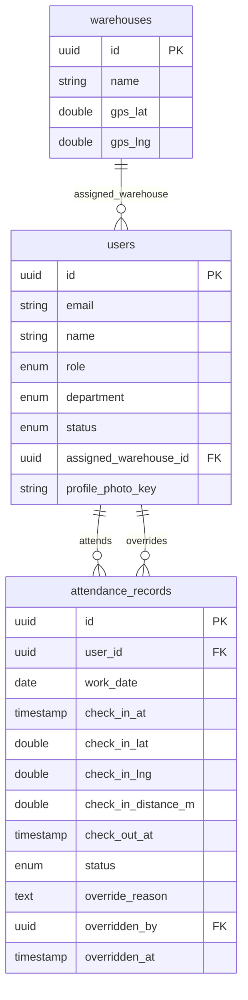

# Data Model: Milestone M2a — HR & Attendance

**Branch**: `feat/m2a-hr-attendance` | **Date**: 2026-10-11  
**Spec**: [spec.md](./spec.md) | **Plan**: [plan.md](./plan.md)

---

## 1. Zero TypeScript Enums (`packages/types` & Drizzle `pgEnum`)

> [!IMPORTANT]
> **Strict Rule**: The TypeScript `enum` keyword is **strictly banned** across the entire codebase. Value sets MUST be defined as `as const` arrays in `packages/types`, with union types derived via `[number]`. Drizzle `pgEnum` definitions in `apps/api` must derive directly from these identical `as const` arrays.

### 1.1 `Department`
```ts
// packages/types/src/index.ts
export const DEPARTMENTS = [
  'TECHNICAL',
  'CUSTOMER_SERVICE',
  'WAREHOUSE',
  'MANAGEMENT',
] as const;
export type Department = (typeof DEPARTMENTS)[number];

// Record object for ergonomic named member access without `enum`:
export const Department = {
  TECHNICAL: 'TECHNICAL',
  CUSTOMER_SERVICE: 'CUSTOMER_SERVICE',
  WAREHOUSE: 'WAREHOUSE',
  MANAGEMENT: 'MANAGEMENT',
} as const;
```
Drizzle schema in `apps/api/src/database/schema/index.ts`:
```ts
import { DEPARTMENTS } from '@alfahd/types';
export const departmentEnum = pgEnum('department', DEPARTMENTS);
```

### 1.2 `UserStatus`
```ts
// packages/types/src/index.ts
export const USER_STATUSES = [
  'ACTIVE',
  'ON_LEAVE',
  'INACTIVE',
] as const;
export type UserStatus = (typeof USER_STATUSES)[number];

export const UserStatus = {
  ACTIVE: 'ACTIVE',
  ON_LEAVE: 'ON_LEAVE',
  INACTIVE: 'INACTIVE',
} as const;
```
Drizzle schema in `apps/api/src/database/schema/index.ts`:
```ts
import { USER_STATUSES } from '@alfahd/types';
export const userStatusEnum = pgEnum('user_status', USER_STATUSES);
```

### 1.3 `AttendanceStatus`
```ts
// packages/types/src/index.ts
export const ATTENDANCE_STATUSES = [
  'ON_TIME',
  'LATE',
] as const;
export type AttendanceStatus = (typeof ATTENDANCE_STATUSES)[number];

export const AttendanceStatus = {
  ON_TIME: 'ON_TIME',
  LATE: 'LATE',
} as const;
```
Drizzle schema in `apps/api/src/database/schema/index.ts`:
```ts
import { ATTENDANCE_STATUSES } from '@alfahd/types';
export const attendanceStatusEnum = pgEnum('attendance_status', ATTENDANCE_STATUSES);
```

---

## 2. Table Schemas

### 2.1 `users` (Extended from M1)

| Column | Type | Constraints | Description |
|---|---|---|---|
| `id` | `uuid` | PK, default `gen_random_uuid()` | Immutable user ID |
| `name` | `varchar(255)` | NOT NULL | Full employee name |
| `email` | `varchar(255)` | NOT NULL, UNIQUE (lowercase) | Normalized login email |
| `password_hash` | `varchar(255)` | NOT NULL | argon2id PHC string |
| `role` | `role` | NOT NULL | `ADMIN`, `WAREHOUSE_STAFF`, `CS`, `TECHNICIAN` |
| `department` | `department` | NULL | Employee department enum |
| `phone` | `varchar(30)` | NULL | Contact mobile number |
| `national_id` | `varchar(30)` | NULL | Egyptian national ID number |
| `hire_date` | `date` | NULL | Date joined company |
| `profile_photo_key` | `varchar(255)` | NULL | Cloudinary `public_id` |
| `status` | `user_status` | NOT NULL, default `ACTIVE` | `ACTIVE`, `ON_LEAVE`, `INACTIVE` |
| `assigned_warehouse_id` | `uuid` | NULL, FK → `warehouses.id` | Home operating warehouse (mandatory for TECHNICIAN) |
| `is_active` | `boolean` | NOT NULL, default `true` | Retained for backward compatibility with M1 |
| `created_at` | `timestamptz` | NOT NULL, default `now()` | Record creation timestamp |
| `updated_at` | `timestamptz` | NOT NULL, default `now()` | Last modification timestamp |

---

### 2.2 `attendance_records` (New in M2a)

| Column | Type | Constraints | Description |
|---|---|---|---|
| `id` | `uuid` | PK, default `gen_random_uuid()` | Attendance entry ID |
| `user_id` | `uuid` | NOT NULL, FK → `users.id` | Technician ID |
| `work_date` | `date` | NOT NULL | Calendar shift date in `Africa/Cairo` |
| `check_in_at` | `timestamptz` | NOT NULL | Exact server UTC timestamp of check-in |
| `check_in_lat` | `double precision` | NOT NULL, CHECK (-90..90) | GPS latitude submitted by device |
| `check_in_lng` | `double precision` | NOT NULL, CHECK (-180..180) | GPS longitude submitted by device |
| `check_in_distance_m` | `double precision` | NOT NULL | Server-calculated Haversine distance in meters |
| `check_out_at` | `timestamptz` | NULL | Exact server UTC timestamp of check-out |
| `status` | `attendance_status` | NOT NULL | `ON_TIME` or `LATE` |
| `override_reason` | `text` | NULL | Justification for admin adjustments |
| `overridden_by` | `uuid` | NULL, FK → `users.id` | Admin who adjusted record |
| `overridden_at` | `timestamptz` | NULL | Timestamp of admin adjustment |
| `created_at` | `timestamptz` | NOT NULL, default `now()` | Record creation timestamp |
| `updated_at` | `timestamptz` | NOT NULL, default `now()` | Last modification timestamp |

**Indexes & Constraints**:
- **Unique Constraint**: `UNIQUE ("user_id", "work_date")` — strictly guarantees at most one check-in per technician per working day.
- **Foreign Keys**: `user_id` → `users(id)`, `overridden_by` → `users(id)`.
- **Check Constraints**: `check_in_lat BETWEEN -90 AND 90`, `check_in_lng BETWEEN -180 AND 180`.

---

## 3. Entity Relationships


